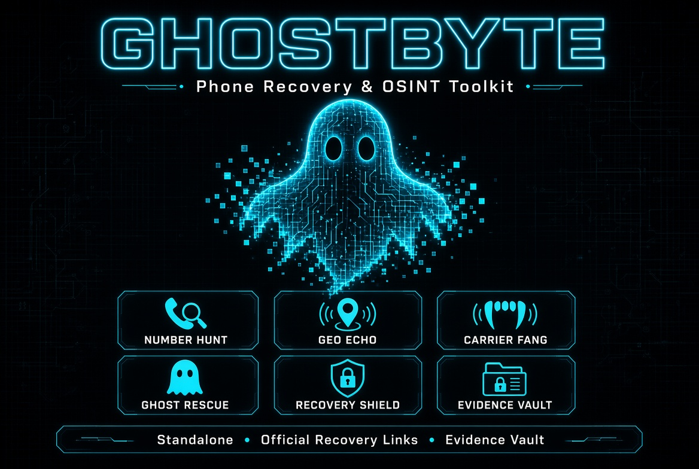

<p align="center">
  <a href="https://hits.sh/github.com/masterxhackerx420-oss/GhostByte/">
    
  </a>
</p>

# GhostByte — Phone Recovery & OSINT Toolkit



Standalone Python toolkit for phone-number intelligence and device recovery guidance.  
Does **not** modify or depend on any existing GlitchByte tools.

## Modules

| Module          | Capabilities                                      |
|-----------------|---------------------------------------------------|
| NUMBER HUNT     | Formatting, validation, public-web research links |
| GEO ECHO        | Country, numbering region, approximate geo clues  |
| CARRIER FANG    | Carrier metadata & provider-contact guidance      |
| GHOST RESCUE    | Android & iPhone recovery links, lost-mode guidance |
| RECOVERY SHIELD | IMEI checklist, SIM suspension, account protection |
| EVIDENCE VAULT  | Locally saved HTML, JSON, and text reports        |

## Features

- Offline phone parsing via `phonenumbers` (Google libphonenumber port)
- No coordinates are invented — only numbering-region data
- Official recovery links only (Google Find My Device, iCloud Find)
- Auto-saves every scan to `reports/` as `.json`, `.txt`, and `.html`
- Clean CLI launcher with rich terminal UI

## Quick Start

```bash
git clone https://github.com/masterxhackerx420-oss/GhostByte.git
cd GhostByte
pip install -r requirements.txt
python launcher.py
```

## Repository Layout

```
GhostByte/
├── launcher.py
├── requirements.txt
├── README.md
├── LICENSE
├── ghostbyte-card.jpg
├── modules/
│   ├── number_hunt.py
│   ├── geo_echo.py
│   ├── carrier_fang.py
│   ├── ghost_rescue.py
│   ├── recovery_shield.py
│   └── evidence_vault.py
└── reports/
```

## Ethical Use

This tool only surfaces **public numbering-plan data** and **official recovery resources**.  
It does not track devices in real time, does not bypass locks, and does not perform unauthorized access.  
Use only on numbers and devices you own or have explicit authorization to investigate.

## License

MIT — use freely, credit optional.
